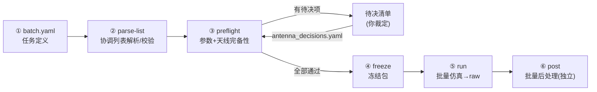

# 01 方案总览

## 1. 目标

对一个**待评估卫星网络**,针对其协调列表中的 N 个协调对象,批量完成 X 频段 NGSO 系统间(同向 EESS,7235–7250 / 8025–8400 MHz)干扰仿真与统计,要求:

1. 协调列表既可来自已有的 200+ 个网络清单,也可来自用户编辑的 Word/PDF/Excel;
2. 一次批量任务允许用户覆盖功率、频率、天线增益、轨道等库内参数;
3. 涉及网络的天线 phi-G 在任务确定后**立即自动数字化**,且**严禁擅自计算**;
4. 输出:原始数据、链路计算表/统计值/散点图/CCDF;后处理与仿真**相互独立**。

不在本期范围:NGSO-EESS → NGSO-FSS 同频反向仿真(列表中保留并标记 `DEFERRED_REV_DIR`)。

## 2. 设计原则

| # | 原则 | 落实方式 |
|---|---|---|
| P1 | **冻结后再跑** | 预检通过后生成"冻结包":每个 pair 一份固定 INPUT 与 provenance,仿真只读冻结包 |
| P2 | **批次级时间冻结** | `batch.yaml` 必须写明 `start_utc`;**禁止 `TODAY`**,否则各 pair 历元不同、太阳同步面升交点也不同 |
| P3 | **禁止静默计算** | 天线按固定优先级取数;任一级失败只能进《待决清单》,不得向下兜底 |
| P4 | **裁定持久化** | 你的每个决定写入 `antenna_decisions.yaml`(文件,不写库),后续批次沿用 |
| P5 | **零硬编码** | 阈值、路径、名称规则、列映射、SQL 全部来自 `configs/`;缺字段即报错 |
| P6 | **引擎解耦** | 只通过适配器接口与 `X-band-NGSO` 及 ITU 数据库交互 |
| P7 | **仿真/后处理分离** | 仿真只产 raw;后处理只读 raw,可无限次重跑 |
| P8 | **容错且可续跑** | 单 pair 失败只记录;已完成 pair 自动跳过 |

## 3. 六步流水线

| 步骤 | 命令 | 输入 | 输出 | 是否需要人 |
|---|---|---|---|---|
| ② | `parse-list` | 协调列表、规则 | 标准协调表 + 校验报告 | 仅匹配歧义时 |
| ③ | `preflight` | 标准表、覆盖、天线策略、决策 | 通过 / 待决清单 | **有待决项时** |
| ④ | `freeze` | 通过预检的任务 | 每 pair 冻结包 | 否 |
| ⑤ | `run` | 冻结包 | raw、provenance、状态 | 否(可通宵) |
| ⑥ | `post` | 批次目录、post.yaml | 链路表/图/汇总 | 否 |

## 4. 对此前方案的修正

本方案相对 `X-band-NGSO/docs/批量整合与问题解决思路.md` 的主要改动:

1. 删去"协调列表列错位"的说法(经核实是解析假象);真实问题是**一格多名 + 后缀 + 校验列全空**。
2. 新增 **P2 批次级时间冻结**(原方案遗漏)。
3. 审批结果**不写回数据库**(与项目"数据库只读"规则一致),改为版本化文件。
4. 指出仿真与数字化库存在**两套天线实现**,要求合并为同一入口,并禁止 `REC-465-6 → 465-5` 这类静默映射。
5. 峰值对齐/尾部补齐不预设阈值,**由你一次性裁定策略**,阈值在配置中。
6. 不重构单 pair 目录语义,只在其上加批次层与索引(避免破坏现有测试);并明确"仿真/后处理解耦"在引擎中已基本存在,缺的是批量编排与跨 pair 汇总。
7. 补充运算量与存储的估算与缓存要求(见 [06](06-batch-layout-and-post.md))。
